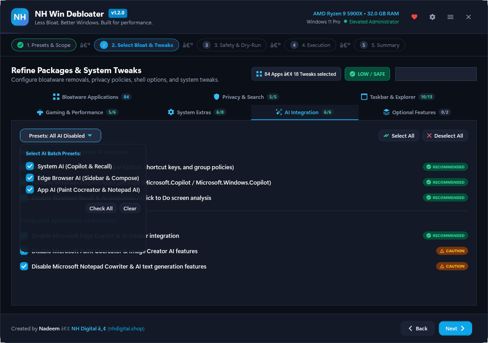

# NH Win Debloater

<p align="center">
  <a href="https://github.com/nadeemhaaju143/nh-win-debloater/releases/tag/v1.2.0"></a>
  <a href="https://microsoft.com/powershell"></a>
  <a href="LICENSE"></a>
  <a href="https://github.com/nadeemhaaju143/nh-win-debloater/wiki"></a>
  <a href="https://nhdigital.shop"></a>
  <a href="https://rzp.io/rzp/nh-win-debloater"></a>
  <a href="https://rzp.io/rzp/j9CGaaRR"></a>
</p>

<p align="center">
  <strong>Less Bloat. Better Windows. Built for pure performance, privacy, and full control.</strong><br>
  A modern, lightweight Windows 10 & 11 optimization assistant crafted with native Material Design 3 and Windows 11 Fluent UI.
</p>

---

## Overview

**NH Win Debloater** is an advanced open-source utility designed, architected, and maintained by **Mohammed Nadeem BM** (**NH Digital**). It safely removes intrusive pre-installed bloatware packages, halts diagnostic telemetry pipelines, suppresses background AI surveillance mechanisms, optimizes non-essential background services, and unlocks peak gaming and workstation responsiveness—without persistent background services, scheduled tasks, or permanent disk overhead.

- 📖 **Comprehensive Documentation:** Full technical specifications, package lists, and rollback guides are available on the **[GitHub Wiki](https://github.com/nadeemhaaju143/nh-win-debloater/wiki)**.
- ☕ **Support Open-Source Engineering:** Support ongoing Windows update parity research, cloud test matrices, and development via **[One-Time Support Tip](https://rzp.io/rzp/nh-win-debloater)** or become a **[Monthly Supporter (₹199/mo)](https://rzp.io/rzp/j9CGaaRR)**.

---

## Performance & Resource Benchmarks

Tested on a clean isolated Windows 11 Enterprise (x64) environment measuring exact resource consumption before debloating, after standard debloat (`v1.0.0`), after deep optimization (`v1.1.0`), and after **`v1.2.0`** (`Recommended Setup` with Event-Batching, Sysprep Hive & Zero-Leak Host):

| Benchmark Metric | Stock Windows Baseline (Before) | After v1.0.0 (`main`) | After v1.1.0 | After v1.2.0 (`Recommended Setup`) | Improvement (v1.1.0 → v1.2.0) | Total Optimization vs. Baseline |
| :--- | :---: | :---: | :---: | :---: | :---: | :---: |
| **RAM In-Use (MB)** | **9,905.8 MB** | **9,225.8 MB** | **8,620.8 MB** | **8,565.8 MB** | **-55.0 MB RAM** | **-1,340.0 MB RAM** |
| **Memory Utilization (%)** | **61.5%** | **57.3%** | **53.5%** | **53.2%** | **-0.3%** | **-8.3%** |
| **Total RAM Freed (MB)** | — | +680.0 MB | +1,285.0 MB | **+1,340.0 MB** | **+55.0 MB extra** | **+1,340.0 MB reclaimed** |
| **Idle CPU Utilization (%)** | **10.5%** | **7.6%** | **4.6%** | **4.0%** | **-0.6% CPU** | **-6.5% CPU** |
| **Active Running Services** | **137** | **131** | **123** | **122** | **-1 services** | **-15 services** |
| **Running Background Processes** | **276** | **260** | **244** | **240** | **-4 processes** | **-36 background tasks** |

> Complete benchmark breakdowns and hardware configuration notes are available in **[docs/BENCHMARKS.md](docs/BENCHMARKS.md)**.

---

## User Interface & Experience

Built natively in pure Windows Presentation Foundation (WPF) with 0 third-party binaries or external DLLs, featuring an integrated single-canvas top bar, custom vector 4-color Windows emblem, and fluid tactile feedback.

### 1. Stage 1: Centered Welcome Screen & Dual Action Paths
Features the custom 4-Pane Multi-Color Windows Emblem, user scope dropdown, and side-by-side action buttons: **Recommended Setup** (curated safe optimizations) and **Custom Tuning** (fine-grained control wizard).


### 2. Stage 2: Fine-Grained Tweak Dropdowns & Dedicated AI Suite
Dark Material multi-select CheckBox dropdowns across all tabs, live selection counters, and safety impact badges.


### 3. Stage 5: Summary, Snapshot Rollback & Selective Restore
Automatic pre-tweak registry snapshot selector, Start Menu layout recovery, and selective restore checkboxes (Apps Only, Tweaks Only, or individual categories).


---

## Usage

### Method 1: Ultra-Short Branded One-Line Launcher (Recommended)

Open **Windows PowerShell** (Run as Administrator recommended for system tweaks) and paste:

```powershell
irm nhdigital.shop/debloat | iex
```

*Short alias:*
```powershell
irm nhdigital.shop/w | iex
```

*Direct GitHub raw fallback:*
```powershell
irm https://raw.githubusercontent.com/nadeemhaaju143/nh-win-debloater/main/Get-NHWinDebloater.ps1 | iex
```

> [!TIP]
> **Pre-Tweak Registry Backups:** Before applying any modifications, NH Win Debloater automatically captures a complete registry snapshot and Start Menu layout backup saved safely to `%LOCALAPPDATA%\NHWinDebloater\Backups`.

> [!IMPORTANT]
> **Selective Restore & 1-Click Rollback:** Returning users can access the **Recovery & Rollback** manager directly via the Quick Actions menu (`☰`), Stage 1, or Stage 5 to restore pre-tweak registry states, selectively reinstall apps, or reverse specific tweak categories without re-running optimizations.

#### Power-User CLI & Simulation Flags
```powershell
# Interactive CLI console mode
& ([ScriptBlock]::Create((irm nhdigital.shop/debloat))) -CLI

# Safe WhatIf simulation mode (zero system modifications)
& ([ScriptBlock]::Create((irm nhdigital.shop/debloat))) -DryRun

# Automated Silent deployment mode
& ([ScriptBlock]::Create((irm nhdigital.shop/debloat))) -Silent
```

### Method 2: Manual Download & Offline Run

For air-gapped systems or manual offline execution:
1. Download or clone this repository to your target machine.
2. Launch via PowerShell:
   ```powershell
   .\run.ps1
   # Or with parameters:
   .\run.ps1 -CLI
   .\run.ps1 -DryRun
   ```
3. Or double-click `Run.bat`, which automatically requests elevation and initializes the environment.

---

## What's New in v1.2.0

- **UI Stability & Event-Loop Batching:** 60 FPS fluid rendering during bulk app operations via `$script:IsUpdatingAppBatch` event suppression, in-memory caching of protected apps, and $O(1)$ dictionary lookups eliminating catalog stutter and layout reflow delays.
- **Top Bar Redesign & Live Hardware Configuration Slot:** Integrated real-time CPU model and Total RAM metrics (<250ms query time) in the top header (`TxtHardwareSpecs`) alongside Windows edition and architecture; streamlined header by moving Recovery/Rollback and Reinstall Apps buttons to the Quick Actions menu (`☰`) and Stage 5.
- **Multi-Language Engine:** High-contrast runtime interface language selection in Preferences (`⚙`) across 6 languages: `System Auto`, `English (US)`, `Hindi (हिन्दी)`, `Kannada (ಕನ್ನಡ)`, `Spanish (Español)`, and `German (Deutsch)`.
- **Sysprep & Default User Profile Hive Scope:** Native `Mount-DefaultUserHive` and `Dismount-DefaultUserHive` utilities for debloating `C:\Users\Default\NTUSER.DAT`—ideal for sysprep golden images and multi-user machines with safe handle release.
- **Streamlined Welcome Screen Flow:** Non-jumping card selection with clean direct routing on Next (**Recommended Setup** routes directly to Stage 3 Review/Apply; **Custom Tuning** opens the full customization wizard in Stage 2).
- **Minimized Background Console & Zero-Leak Exit:** Suppressed console host window on launch (`SW_MINIMIZE = 2`) and guaranteed `%TEMP%\NHWinDebloater*` scratch directory purging on exit with zero orphan background processes.
- **Updated Benchmark Metrics:** Reclaimed **1,340 MB total RAM** (+55 MB over v1.1.0), 4.0% idle CPU, and 36 background processes reduced.

---

## What's New in v1.1.0

- **Integrated Single-Canvas Top Bar:** Unified borderless canvas with 4 top-right controls: Heart Support (`♥`), Settings (`⚙`), 3-Line Menu (`☰`), and Close (`✕`).
- **Hero Welcome Screen:** Centered landing view with custom vector 4-pane multi-color Windows emblem (`#EF4444`, `#10B981`, `#0EA5E9`, `#F59E0B`), scope bar, and dual action buttons (**Recommended Setup** & **Custom Tuning**).
- **Preferences Modal (`⚙`):** Live color theme switching (`System Auto`, `Light Mode`, `Dark Mode`), interface language selection, and safety behavior toggles.
- **3-Line Quick Actions Menu (`☰`):** Direct access to `Load JSON Profile`, `Save JSON Profile` (with category modal), `Recovery & Rollback` (3 recovery utilities), `Documentation`, `Report an Issue`, `Open Session Logs`, and `About NH Win Debloater`.
- **Deep Bloat & Stub Removal:** Deep OneDrive removal (processes, setup, Appx sync, CLSID, Run keys), deep Windows Copilot removal, and Start Menu cloud stub clearing (`DisableWindowsConsumerFeatures = 1`, `SilentInstalledAppsEnabled = 0`, layout backup/reset).
- **Safe Background Service & Startup Optimization:** Curated reversible background service tuning (`DiagTrack`, `dmwappushservice`, `RetailDemo`, `MapsBroker`, `WerSvc`, `wisvc`, `Fax`, `PhoneSvc`) and high-RAM autostart trimming, while safeguarding Windows Defender, Windows Update, Network, Audio, and GPU.
- **App Safety Indicators & Legend:** Color-coded status dots and badges (`Recommended` Green `#10B981`, `Optional` Amber `#F59E0B`, `Not Recommended` Red `#EF4444`) with a bottom legend bar.
- **Automatic Exit Cleanup:** Automatic purge of temporary launcher sandbox files (`%TEMP%\NHWinDebloater*`) on exit, preserving logs and backups.

---

## Features Overview

For complete breakdowns, key paths, and policy documentation, refer to the **[GitHub Wiki](https://github.com/nadeemhaaju143/nh-win-debloater/wiki)**:

- **[Privacy & Telemetry Protection](https://github.com/nadeemhaaju143/nh-win-debloater/wiki/Features#1-privacy--telemetry-protection):** Suppresses Windows diagnostic telemetry (`AllowTelemetry = 0`), advertising ID profiling, CEIP scheduled tasks, and handwriting/typing behavioral trackers.
- **[Dedicated AI Integration Suite](https://github.com/nadeemhaaju143/nh-win-debloater/wiki/Features#2-dedicated-ai-integration-suite):** Disables Windows Copilot (`Win + C`), Windows Recall local snapshot indexing, Click To Do AI context flyouts, Paint AI generation, Notepad AI rewrite, and cloud AI telemetry.
- **[Shell & Explorer Customization](https://github.com/nadeemhaaju143/nh-win-debloater/wiki/Features#3-shell--taskbar-customization):** Classic Windows 10 right-click context menu, Taskbar left/center alignment, Bing search highlight suppression, Gallery namespace removal, Launch Explorer to "This PC", and compact folder spacing.
- **[Gaming & Hardware Performance](https://github.com/nadeemhaaju143/nh-win-debloater/wiki/Features#4-gaming--hardware-performance):** Disables Game DVR background recording, disables Windows Power Throttling, enforces 1:1 linear mouse acceleration curve, eliminates Sticky Keys popups, and reclaims SSD storage from `hiberfil.sys`.
- **[System Extras & Promos](https://github.com/nadeemhaaju143/nh-win-debloater/wiki/Features#5-system-extras--commercial-promos):** Blocks automatic consumer application installs, lock screen tips/nudges, and Edge background pre-launching.
- **[App Removal & Protected Core Packages](https://github.com/nadeemhaaju143/nh-win-debloater/wiki/App-Removal):** Multi-select removal across 80+ bloatware packages with safety dots and badges while strictly safeguarding Microsoft Store, Windows Security (`Microsoft.SecHealthUI`), and WinGet. Includes 1-click built-in app reinstaller.
- **[Reverting Changes & Safety Recovery](https://github.com/nadeemhaaju143/nh-win-debloater/wiki/Reverting-Changes):** Start-Screen Restore shortcut, selective multi-select rollback, 1-Click Full System Rollback, and Start Menu layout recovery.

---

## Safety & Invariants

- **Zero Persistent Overhead:** Does not install background daemons, drivers, polling services, or startup items.
- **Automatic Sandbox Cleanup:** Temporary bootstrap files in `%TEMP%\NHWinDebloater_*` are purged immediately on exit. User backups and logs in `%LOCALAPPDATA%\NHWinDebloater\` are strictly preserved.
- **Zero Third-Party Binaries:** Contains 0 compiled `.exe` or `.dll` files. 100% human-readable PowerShell and XAML.
- **DPI-Safe & Fluent Visuals:** Native vector SVG path icons, Segoe UI Variable typography, and smooth 150ms cubic transitions.

---

## Author & Media / Press Contact

**NH Win Debloater** is developed, maintained, and published by **Mohammed Nadeem BM** (**NH Digital**).

- **Creator & Lead Developer:** **Mohammed Nadeem BM**
- **Studio / Brand:** **NH Digital** ([https://nhdigital.shop](https://nhdigital.shop))
- **GitHub:** [@nadeemhaaju143](https://github.com/nadeemhaaju143)
- **Repository:** [https://github.com/nadeemhaaju143/nh-win-debloater](https://github.com/nadeemhaaju143/nh-win-debloater)
- **Official Launcher Route:** [https://nhdigital.shop/debloat](https://nhdigital.shop/debloat)
- **Copyright:** Copyright (c) 2026 Mohammed Nadeem BM (NH Digital)

### Editorial & Press Verification
Technology journalists, reviewers, and publications (including Windows Latest, Neowin, gHacks, BleepingComputer, XDA Developers) evaluating **NH Win Debloater** can cite and attribute **Mohammed Nadeem BM** (`NH Digital`) as the creator and lead developer. All releases and source trees are cryptographically tagged and publicly hosted at `nadeemhaaju143/nh-win-debloater`.

---

## License

Released under the permissive [MIT License](LICENSE).  
Copyright (c) 2026 Mohammed Nadeem BM (NH Digital).
