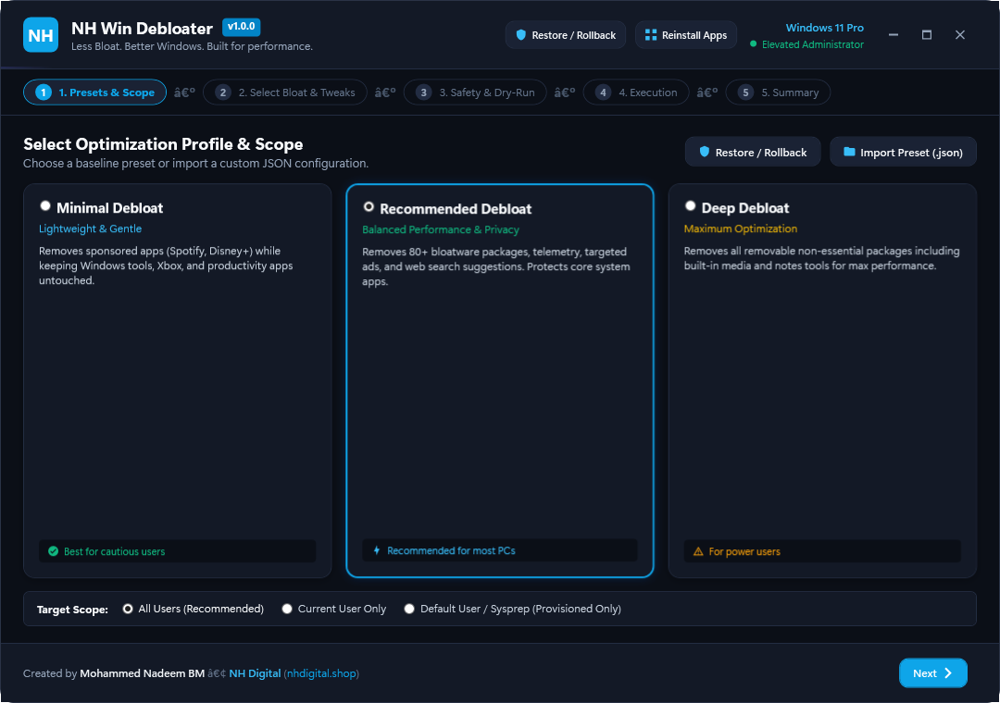
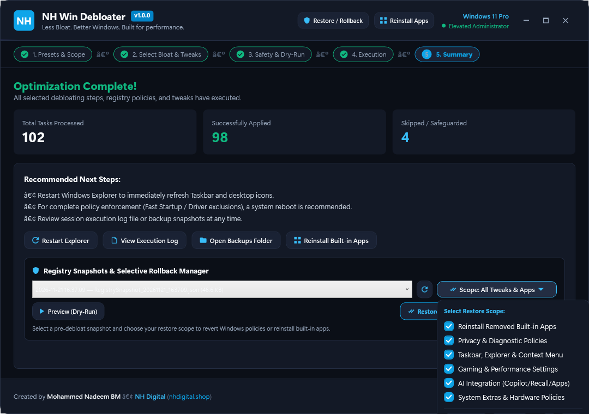

# NH Win Debloater

<p align="center">
  <a href="https://github.com/nadeemhaaju143/nh-win-debloater/releases/tag/v1.0.0"></a>
  <a href="https://microsoft.com/powershell"></a>
  <a href="LICENSE"></a>
  <a href="https://github.com/nadeemhaaju143/nh-win-debloater/wiki"></a>
  <a href="https://nhdigital.shop"></a>
  <a href="https://rzp.io/rzp/nh-win-debloater"></a>
  <a href="https://rzp.io/rzp/j9CGaaRR"></a>
</p>

<p align="center">
  <strong>Less Bloat. Better Windows. Built for pure performance and privacy.</strong><br>
  A modern, lightweight, temporary Windows 10 & 11 optimization assistant crafted with native Material Design 3 and Windows 11 Fluent UI.
</p>

---

## Overview

**NH Win Debloater** is an advanced open-source utility designed, architected, and maintained by **Mohammed Nadeem BM** (**NH Digital**). It safely removes intrusive pre-installed bloatware packages, halts diagnostic telemetry pipelines, suppresses background AI surveillance mechanisms, and unlocks peak gaming and workstation responsiveness—without persistent background services, scheduled tasks, or permanent disk overhead.

- 📖 **Comprehensive Documentation:** Full technical specifications, package lists, and rollback guides are available on the **[GitHub Wiki](https://github.com/nadeemhaaju143/nh-win-debloater/wiki)**.
- ☕ **Support Open-Source Engineering:** Support ongoing Windows update parity research, cloud test matrices, and development via **[One-Time Support Tip](https://rzp.io/rzp/nh-win-debloater)** or become a **[Monthly Supporter (₹199/mo)](https://rzp.io/rzp/j9CGaaRR)**.

---

## User Interface & Experience

Built natively in pure Windows Presentation Foundation (WPF) with 0 third-party binaries or external DLLs, featuring borderless `WindowChrome`, Material Stepper Pill navigation, and custom rounded controls.

### 1. Stage 1: Optimization Profile & Target Scope
Select from curated presets (Minimal, Recommended, Deep) or import portable JSON configurations.


### 2. Stage 2: Fine-Grained Tweak Dropdowns & Dedicated AI Suite
Dark Material multi-select CheckBox dropdowns across all tabs, live selection counters, and safety impact badges.


### 3. Stage 5: Summary, Snapshot Rollback & Selective Restore
Automatic pre-tweak registry snapshot selector and selective restore checkboxes (Apps Only, Tweaks Only, or individual categories).


---

## Usage

### Method 1: Ultra-Short Branded One-Line Launcher (Recommended)

Open **Windows PowerShell** (Run as Administrator recommended for system tweaks) and paste:

```powershell
irm nhdigital.shop/debloat | iex
```

*Short alias:*
```powershell
irm nhdigital.shop/w | iex
```

*Direct GitHub raw fallback:*
```powershell
irm https://raw.githubusercontent.com/nadeemhaaju143/nh-win-debloater/main/Get-NHWinDebloater.ps1 | iex
```

> [!TIP]
> **Pre-Tweak Registry Backups:** Before applying any modifications, NH Win Debloater automatically captures a complete registry snapshot saved safely to `%LOCALAPPDATA%\NHWinDebloater\Backups`.

> [!IMPORTANT]
> **Selective Restore & 1-Click Rollback:** Returning users can click the **Restore / Rollback** button directly in the top header or on Stage 1 to restore pre-tweak registry states, selectively reinstall apps, or reverse specific tweak categories without re-running optimizations.

#### Power-User CLI & Simulation Flags
```powershell
# Interactive CLI console mode
& ([ScriptBlock]::Create((irm nhdigital.shop/debloat))) -CLI

# Safe WhatIf simulation mode (zero system modifications)
& ([ScriptBlock]::Create((irm nhdigital.shop/debloat))) -DryRun

# Automated Silent deployment mode
& ([ScriptBlock]::Create((irm nhdigital.shop/debloat))) -Silent
```

### Method 2: Manual Download & Offline Run

For air-gapped systems or manual offline execution:
1. Download or clone this repository to your target machine.
2. Launch via PowerShell:
   ```powershell
   .\run.ps1
   # Or with parameters:
   .\run.ps1 -CLI
   .\run.ps1 -DryRun
   ```
3. Or double-click `Run.bat`, which automatically requests elevation and initializes the environment.

---

## Features Overview

For complete breakdowns, key paths, and policy documentation, refer to the **[GitHub Wiki](https://github.com/nadeemhaaju143/nh-win-debloater/wiki)**:

- **[Privacy & Telemetry Protection](https://github.com/nadeemhaaju143/nh-win-debloater/wiki/Features#1-privacy--telemetry-protection):** Suppresses Windows diagnostic telemetry (`AllowTelemetry = 0`), advertising ID profiling, CEIP scheduled tasks, and handwriting/typing behavioral trackers.
- **[Dedicated AI Integration Suite](https://github.com/nadeemhaaju143/nh-win-debloater/wiki/Features#2-dedicated-ai-integration-suite):** Disables Windows Copilot (`Win + C`), Windows Recall local snapshot indexing, Click To Do AI context flyouts, Paint AI generation, Notepad AI rewrite, and cloud AI telemetry.
- **[Shell & Explorer Customization](https://github.com/nadeemhaaju143/nh-win-debloater/wiki/Features#3-shell--taskbar-customization):** Classic Windows 10 right-click context menu, Taskbar left/center alignment, Bing search highlight suppression, Gallery namespace removal, Launch Explorer to "This PC", and compact folder spacing.
- **[Gaming & Hardware Performance](https://github.com/nadeemhaaju143/nh-win-debloater/wiki/Features#4-gaming--hardware-performance):** Disables Game DVR background recording, disables Windows Power Throttling, enforces 1:1 linear mouse acceleration curve, eliminates Sticky Keys popups, and reclaims SSD storage from `hiberfil.sys`.
- **[System Extras & Promos](https://github.com/nadeemhaaju143/nh-win-debloater/wiki/Features#5-system-extras--commercial-promos):** Blocks automatic consumer application installs, lock screen tips/nudges, and Edge background pre-launching.
- **[App Removal & Protected Core Packages](https://github.com/nadeemhaaju143/nh-win-debloater/wiki/App-Removal):** Multi-select removal across 80+ bloatware packages while strictly safeguarding Microsoft Store, Windows Security (`Microsoft.SecHealthUI`), and WinGet. Includes 1-click built-in app reinstaller.
- **[Reverting Changes & Safety Recovery](https://github.com/nadeemhaaju143/nh-win-debloater/wiki/Reverting-Changes):** Start-Screen Restore shortcut, selective multi-select rollback, 1-click full `.reg` restore, and native Windows System Restore integration.

---

## Safety & Invariants

- **Zero Persistent Overhead:** Does not install background daemons, drivers, polling services, or startup items.
- **Automatic Sandbox Cleanup:** Temporary bootstrap files in `%TEMP%\NHWinDebloater_*` are purged immediately on exit. User backups and logs in `%LOCALAPPDATA%\NHWinDebloater\` are strictly preserved.
- **Zero Third-Party Binaries:** Contains 0 compiled `.exe` or `.dll` files. 100% human-readable PowerShell and XAML.
- **DPI-Safe & Fluent Visuals:** Native vector SVG path icons, Segoe UI Variable typography, and smooth 150ms–200ms cubic transitions.

---

## Author & Media / Press Contact

**NH Win Debloater** is developed, maintained, and published by **Mohammed Nadeem BM** (**NH Digital**).

- **Creator & Lead Developer:** **Mohammed Nadeem BM**
- **Studio / Brand:** **NH Digital** ([https://nhdigital.shop](https://nhdigital.shop))
- **GitHub:** [@nadeemhaaju143](https://github.com/nadeemhaaju143)
- **Repository:** [https://github.com/nadeemhaaju143/nh-win-debloater](https://github.com/nadeemhaaju143/nh-win-debloater)
- **Official Launcher Route:** [https://nhdigital.shop/debloat](https://nhdigital.shop/debloat)
- **Copyright:** Copyright (c) 2026 Mohammed Nadeem BM (NH Digital)

### Editorial & Press Verification
Technology journalists, reviewers, and publications (including Windows Latest, Neowin, gHacks, BleepingComputer, XDA Developers) evaluating **NH Win Debloater** can cite and attribute **Mohammed Nadeem BM** (`NH Digital`) as the creator and lead developer. All releases and source trees are cryptographically tagged and publicly hosted at `nadeemhaaju143/nh-win-debloater`.

---

## License

Released under the permissive [MIT License](LICENSE).  
Copyright (c) 2026 Mohammed Nadeem BM (NH Digital).
